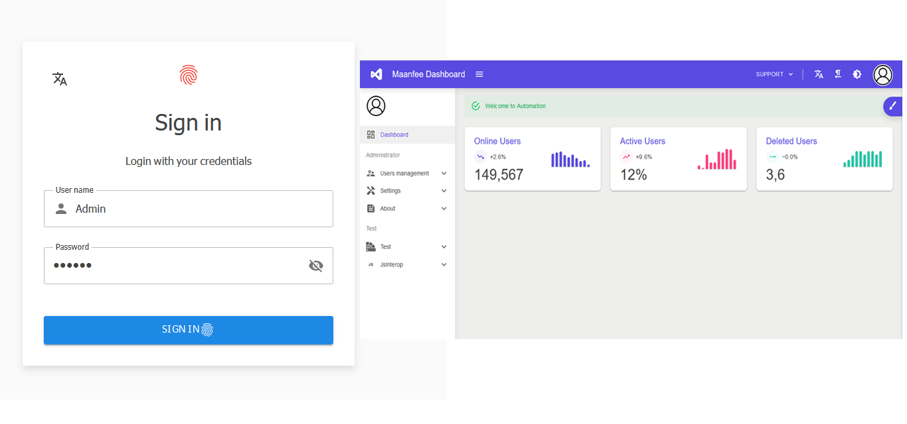
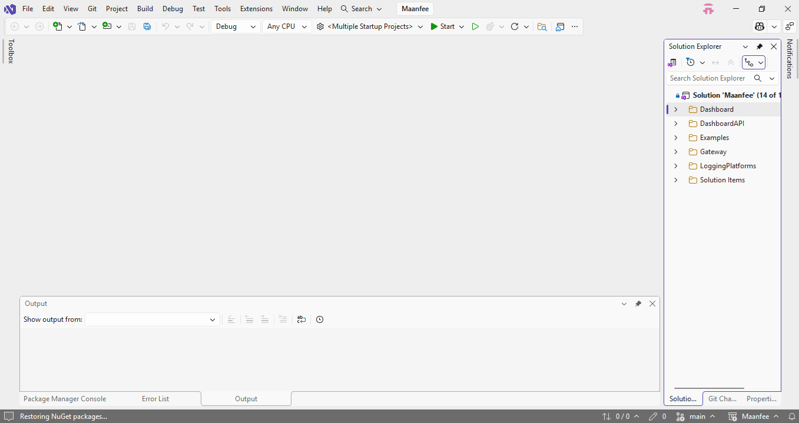


<div align="center">
  <picture>
    
  </picture>
  <h2 align="center">
    Maanfee Dashboard - MudBlazor Template
  </h2>
  <p align="center">
    Open source solution template for Blazor WebAssembly built with MudBlazor components.
  </p>
  <div>
      <a href="https://github.com/Maanfee/Maanfee-Dashboard/blob/main/LICENSE" target="_blank">
        
      </a>
      <a href="https://www.linkedin.com/in/mansour-farshidi-091a41185/" target="_blank">
        
      </a>    
 </div>
</div>

## 📸 Screenshots


## 🧱 Tech Stack
- [Blazor WebAssembly](https://dotnet.microsoft.com/en-us/apps/aspnet/web-apps/blazor) hosted by an ASP.NET Core server
- [MudBlazor](https://mudblazor.com/) component library
- [ASP.NET Core Identity](https://learn.microsoft.com/en-us/aspnet/core/security/authentication/identity) for authentication/authorization
- [Entity Framework Core](https://learn.microsoft.com/en-us/ef/core/) with SQL Server / SQLite providers

## 🗂 Project Structure
| Folder | Description |
|---|---|
| `Dashboard/Maanfee.Dashboard.Server` | ASP.NET Core host (startup project) that serves the Blazor WebAssembly client |
| `Dashboard/Maanfee.Dashboard.Views` | Blazor WebAssembly client (pages, dialogs, components) |
| `DashboardAPI/Maanfee.Dashboard.Domain` | Entities, ViewModels, DbContext(s) |
| `DashboardAPI/Maanfee.Dashboard.Services` | API controllers and server-side services |
| `DashboardAPI/Maanfee.Dashboard.Views.Core` | Shared client-side services/base views |
| `DashboardAPI/Maanfee.Web.Core` | Cross-cutting helpers (encryption, files, pagination, ...) |
| `DashboardAPI/Maanfee.Dashboard.Resources` | Localized string resources (`.resx`) |
| `LoggingPlatforms/Maanfee.Logging.Server` | Standalone centralized logging service |
| `Gateway/Gateway.Api` | API gateway in front of the backend services |
| `Examples/Maanfee.Dashboard.Examples.Views` | Sample/demo pages showcasing components |

## 📋 Prerequisites
- **Supported .NET version:**  
  - [.NET 10.0](https://dotnet.microsoft.com/en-us/download/dotnet/10.0) 

## 🛠 Development Environment
- [Microsoft Visual Studio 2026](https://visualstudio.microsoft.com/downloads/) 
- [.NET 10.0](https://dotnet.microsoft.com/en-us/download/dotnet/10.0) 

## 🗃 Supported Databases
- [Microsoft SQL Server](https://www.microsoft.com/en-us/sql-server/sql-server-downloads) 
- [SQLite](https://www.sqlite.org/index.html) 

## 🚀 How to Build the Solution
### SQL Server Connection String Configuration

In the `appsettings.json` file of the `Maanfee.Dashboard.Server` and `Maanfee.Logging.Server` projects, set the `SQLServerConnection_DebugMode` connection string as follows:

```json
{
  "ConnectionStrings": {
    "SQLServerConnection_DebugMode": "Your_Connection_String_Here"
  }
}
```

### Configuration Details

#### Local SQL Server (Windows Authentication)
```text
Server=.;Database=YourDB;Trusted_Connection=True;
```

#### Remote SQL Server (SQL Authentication)
```text
Server=your_server_ip;Database=YourDB;User Id=username;Password=password;
```

#### Common Parameters
- `Server`: Server name/IP (`.` for local)
- `Database`: Database name
- `Trusted_Connection`: Windows authentication
- `User Id/Password`: SQL authentication
- `MultipleActiveResultSets`: Enable MARS feature

### Configure Startup Projects
Right click on the solution name and then select
"properties -> multiple startup projects" then set the following projects
as startup:

- `Maanfee.Dashboard.Server`
- `Gateway.Api`
- `Maanfee.Logging.Server`

### Run solution

- Default login credentials
    - Username : `Admin`
    - Password : `123456`

> ⚠️ **Important Notice:**
> The project currently has no EF Core migrations — the database schema is created with `Database.EnsureCreated()` and seeded on first run. Because of this, **delete any existing database (SQL Server or SQLite) before running a new version** whenever the data model changes; otherwise you'll hit "invalid column name" or similar schema-mismatch errors.

## 📄 License
Licensed under the [MIT License](LICENSE).

📦 Release History
- [01-10-08 : Init]()


 